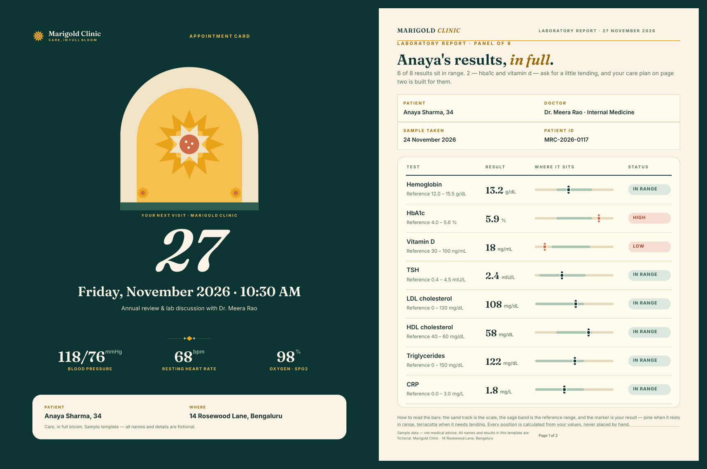
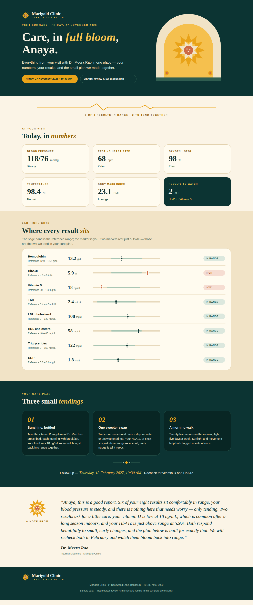
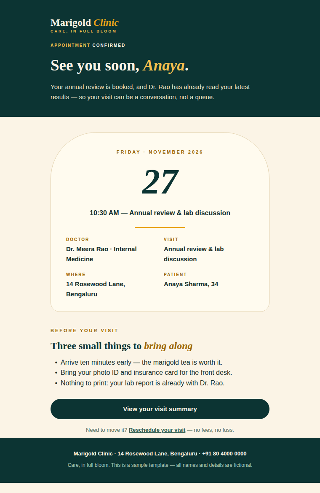
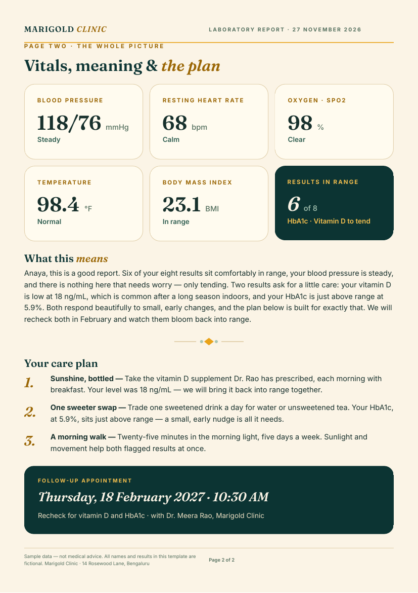

# Marigold — The Clinic Kit

**Care, in full bloom.** A complete clinic communications kit built with [Hyper Elements](https://hyperelements.dev): one fictional patient file becomes an appointment **Email**, a visit-summary **Page**, a two-page lab-report **Document** (PDF), and an appointment **Canvas** poster — one theme, four roots, every number computed from the data.



> **Live demo:** https://marigold-the-clinic-kit.vercel.app/
> **Validation:** `0 errors · 0 warnings` on all four templates · 7 email-client previews rendered

All names, results and details are fictional sample data. This is a design template, not medical advice.

---

## The four outputs

| Root | Template | What it is |
|---|---|---|
| `Email` (600) | Appointment confirmation | Pine hero, an arch-topped appointment card with a giant Fraunces italic date, visit facts, a pre-visit list and a reschedule link. No Svg (email can't) — the art is colour bands and typography. |
| `Page` (1120) | Visit summary | The showpiece: sun-arch hero with a drawn marigold, an ECG pulse band, vitals grid, the full lab panel with range bars, a dark care-plan section, and the doctor's note as an italic pull-quote. |
| `Document` (A4, 2 pp) | Lab report PDF | Page header/footer with real page numbers, patient/doctor meta table, all 8 results with computed range bars and status chips, then vitals, interpretation, care plan and follow-up. |
| `Canvas` (1080×1350) | Appointment poster | Portrait card: arch + marigold art, huge italic date, three vitals, patient card. Rendered to PNG and SVG. |



## One file in, everything out

Everything is driven by a single patient record in [`src/data.ts`](src/data.ts): patient, doctor, appointment, vitals, an 8-test lab panel (value, unit, reference low/high), a 3-step care plan and the doctor's note.

Nothing about the results is hard-coded for looks:

- **Status is computed** — `value < refLow → low`, `value > refHigh → high`, else `in range` — and drives the chip colour (terracotta is used *only* for flags).
- **Every range-bar position is computed** from the value against its reference range; the marker lands where the result truly sits.
- The sample panel deliberately has **exactly 2 of 8 results out of range** (Vitamin D low, HbA1c just high), and the doctor's note, the "results to watch" card and the care plan are all built around those same two — change a value in `data.ts` and the whole story re-renders consistently across all four formats.

## How Hyper Elements is used

- **One `defineTheme()`** ([`src/theme.ts`](src/theme.ts)) — the Marigold system: deep pine `#0C3433`, cream `#FBF4E6`, marigold `#E9A319`, terracotta for flags only; Fraunces for display, Inter for data; pill buttons; named card styles. Per-format behaviour comes from the same theme.
- **Shared components** ([`src/components.tsx`](src/components.tsx)) used by multiple roots: a marigold flower drawn in `Svg` from computed petal rings, a sun-arch `HeroArt`, an ECG `PulseLine`, stat cards, status chips, `RangeBar`s and petal dividers. The Email uses an Svg-free wordmark variant, because Svg isn't available in email.
- **All four roots** — `Email`, `Page`, `Document` (with `PageHeader`, `PageFooter`, `PageNumber`), and `Canvas`.
- **`validate()` as a build gate** — [`src/render.ts`](src/render.ts) validates every template first (the Email also with the `@hyper-elements/email-clients` plugin) and fails the build on any error diagnostic.
- **Real output pipelines** — Email and Page via `render()`, the Document via `renderPdf()` from `@hyper-elements/react/pdf`, the Canvas via `renderImage()` from `@hyper-elements/react/image`, with real Fraunces/Inter font files passed as bytes to the PDF/image renderers.
- **Email-client previews** — `renderInEmailClients()` writes previews for Outlook, Outlook.com (Windows/Mac), Gmail (web/Mac), Apple Mail and Apple Mail on iPhone into `out/email-clients/`. The only diagnostics are 11 informational notes about classic Outlook behaviour (letter-spacing, rounded corners, hover) — graceful degradation, nothing broken.



## Run it

```bash
npm install
npm run build   # validate + render everything into out/
npm run check   # validate only
```

Outputs land in `out/`:

- `appointment-email.html` / `.txt`
- `visit-summary.html` / `.txt`
- `lab-report.pdf` (2 pages, A4) + `lab-report.html` (print HTML)
- `appointment-poster.png` / `.svg`
- `email-clients/` — 7 client previews

A static showcase of the rendered outputs lives in [`site/`](site/) (`site/index.html`) — that's the live demo.

## Project structure

```
src/
  data.ts        the one patient file (edit this, re-run build)
  theme.ts       defineTheme() — the Marigold design system
  components.tsx shared art + data components (flower, arch, range bars…)
  email.tsx      Email root — appointment confirmation
  page.tsx       Page root — visit summary
  document.tsx   Document root — lab report
  canvas.tsx     Canvas root — appointment poster
  render.ts      validate + render + email-client previews → out/
  check.ts       validate-only gate
assets/fonts/    Fraunces + Inter (SIL OFL, via Fontsource)
docs/screenshots/  README images
site/            static live-demo site
```

## Design notes

Healthcare templates usually look like hospital software. Marigold borrows from editorial and boutique-hospitality design instead: a dramatic serif (Fraunces, with italics doing the emotional work), a drawn flower-and-sun-arch motif, generous space, and a strict rule that colour means something — pine and cream for calm, marigold for warmth, terracotta only where a result needs attention. The tone follows the design: results are "tended", not "failed".



## Credits

- Built with [Hyper Elements](https://github.com/hyper-elements/hyper-elements) (`@hyper-elements/react` 0.5.0).
- Fonts: Fraunces and Inter, SIL Open Font License, via Fontsource.
- Marigold Clinic, Anaya Sharma and Dr. Meera Rao are fictional.
